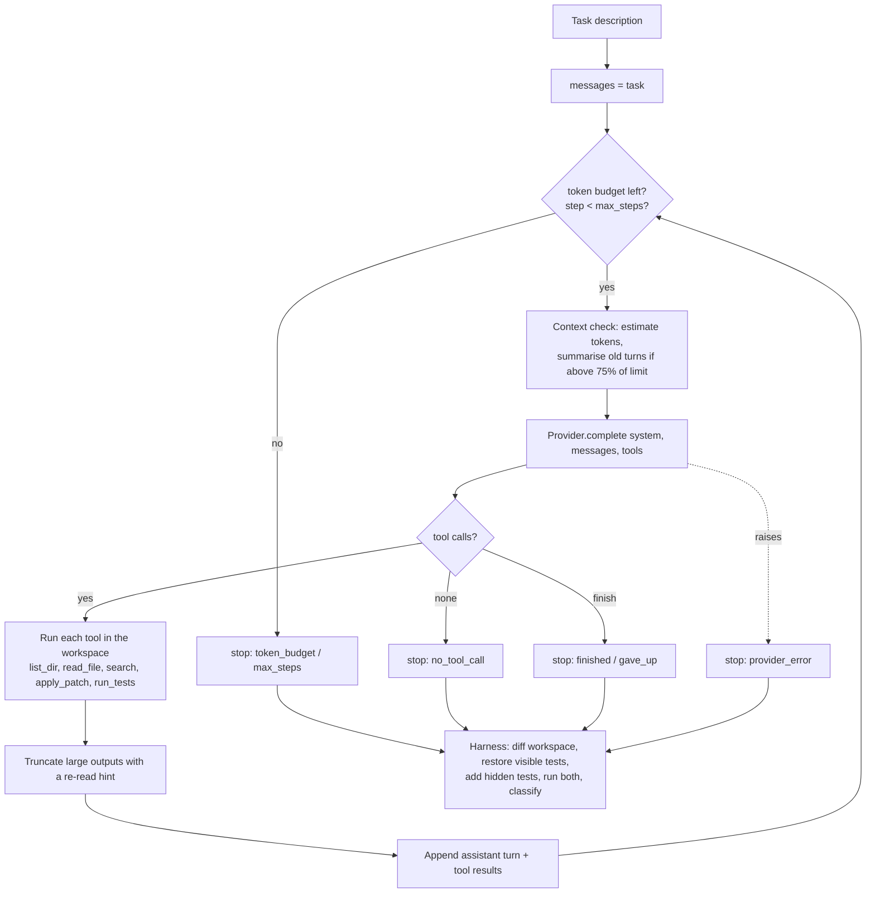

# mini-coding-agent

A small coding agent written from scratch in Python (no agent framework), plus a
SWE-bench-style harness that measures it on 20 self-contained buggy packages. The
agent explores a repository, reproduces the bug with the tests, edits code with
unified diffs, verifies, and stops. Every file and test command is confined to a
throwaway working copy. The harness runs each task in isolation, scores the
result against hidden tests the agent never sees, records the full trajectory as
JSONL, labels every failure (wrong file, broken patch, gave up, test overfit,
budget exceeded, incorrect fix, provider error) and renders each run as a static HTML page. It
builds, tests and demos with zero API keys; the live Claude provider switches on
only when you ask for it and `ANTHROPIC_API_KEY` is set.

## The agent loop



## Quickstart

```bash
pip install -e ".[dev]"
```

```bash
python -m mini_agent demo
```

```bash
python -m mini_agent bench
```

`demo` runs one task with the mock provider and prints every step. `bench` runs
all 20 tasks with both strategies and writes `bench/results/mock/`. Then
`python -m mini_agent view bench/results/mock` writes an HTML viewer to
`bench/results/mock/viewer/index.html`. For a live run:
`pip install -e ".[live]"`, set `ANTHROPIC_API_KEY`, and add
`--provider anthropic --out bench/results/live`.

## Demo trajectory

`python -m mini_agent demo --task 03` (mock provider, trimmed). The scripted
policy sends a patch with stale context on purpose, gets a precise error back,
re-reads the file and recovers:

```text
[step 1] Let me see what is in the repository.
  -> list_dir(path='.')
  <- ok: numstats/  tests/
[step 2] Reading the code that looks relevant.
  -> read_file(path='numstats/central.py')
         4 |     return ordered[len(ordered) // 2]
[step 3] Running the tests to reproduce the bug.
  -> run_tests()
  <- exit code 1 ... assert 3 == 2.5
[step 4] Applying a fix.
  -> apply_patch()
  <- ERROR
      Patch rejected, no files were changed. hunk 1 for numstats/central.py does not
      match the file. ... Re-read the file with read_file and copy context lines exactly.
[step 5] The patch did not apply; re-reading the file.
  -> read_file(path='numstats/central.py')
[step 6] Retrying with exact context.
  -> apply_patch()
  <- Patch applied: modified numstats/central.py (+4 -1)
[step 7] Re-running the tests.
  <- exit code 0 ... 2 passed
[step 8] Wrapping up.
  -> finish(status='done', summary='Fixed the bug; all tests pass.')

stopped: finished after 8 steps, tokens in/out 8274/310
evaluation: visible tests pass, hidden tests pass -> PASS
```

## Benchmark results

### Mock mode (committed in `bench/results/mock/`)

> **These numbers only prove the harness works.** The mock provider is a
> scripted oracle that is handed the reference fix and fails on purpose on 7
> tasks so every failure category is exercised. Token counts are chars/4
> estimates; cost is what those tokens would cost at `claude-opus-5-5` prices
> ($4 / $20 per million input / output tokens).

| strategy | pass@1 | avg steps | total tokens | avg tokens | est. cost (USD) |
|---|---|---|---|---|---|
| direct (mock) | 15/20 (75%) | 7.3 | 167,604 | 8,380 | 0.73 |
| plan (mock) | 15/20 (75%) | 8.2 | 193,831 | 9,692 | 0.84 |

| failure category | direct (mock) | plan (mock) |
|---|---|---|
| provider_error | 0 | 0 |
| budget_exceeded | 1 | 1 |
| broken_patch | 1 | 1 |
| gave_up | 1 | 1 |
| wrong_file | 1 | 1 |
| test_overfit | 1 | 1 |
| incorrect_fix | 0 | 0 |

The plan strategy costs exactly one extra step per task in mock mode (the
planning turn). That shows the comparison runs end to end, nothing more.

### Live mode

Not run yet: the build environment had no API access. Run
`python -m mini_agent bench --provider anthropic --out bench/results/live` to
produce `bench/results/live/results.md`, which is labelled LIVE.

## Design decisions and tradeoffs

Each has a longer write-up in [`docs/adr/`](docs/adr) and
[`DECISIONS.md`](DECISIONS.md).

- **Hand-written loop behind a provider interface** ([ADR 0001](docs/adr/0001-hand-written-agent-loop.md)).
  The loop is the thing being studied, so it is plain code. The cost is owning
  its edge cases, covered by one test per stop condition.
- **Own unified diff applier** ([ADR 0002](docs/adr/0002-own-unified-diff-applier.md)).
  Line numbers are hints, matching is exact (trailing whitespace forgiven),
  application is all or nothing, and errors tell the model how to recover.
  Tradeoff: no renames or fuzzy matching.
- **Mock mode is an oracle with injected faults** ([ADR 0003](docs/adr/0003-mock-providers.md)).
  Deterministic and honest about meaning nothing; CI asserts its fixed 75% so
  the mock run doubles as a regression test.
- **Truncation plus keep-tail summarisation** ([ADR 0004](docs/adr/0004-context-management.md)).
  Rule-based and free. Thinking blocks are dropped from retained turns because
  the API rejects them once earlier history changes. Tradeoff: the digest is
  lossy compared with an LLM summary.
- **Hidden tests, restored visible tests, ordered taxonomy** ([ADR 0005](docs/adr/0005-evaluation-and-failure-taxonomy.md)).
  Editing tests cannot fake a pass and overfitting is its own category. Labels
  are rules, so they are cheap and reproducible but coarse.
- **Append-only conversations.** One system prompt and one tool list for the
  whole run (the plan strategy plans in its first turn rather than in a
  separate call), so prompt caching and thinking-block replay keep working.
- **Prompt caching in live mode.** The conversation is append-only, so each
  request's prefix was already sent on the previous step; top-level
  `cache_control` lets the API bill it at the cache-read rate (0.05x input on
  `claude-opus-5-5`). Cache reads and writes are tracked and priced separately.
  Summarisation resets the cache once, which is the price of a smaller context.
- **Retries live in one place.** The SDK already retries 429, 5xx, timeouts
  and dropped connections with exponential backoff and jitter; the provider
  sets 5 retries and a 10 minute timeout instead of adding a second retry
  layer. Anything that still fails ends that run as `provider_error`.
- **pass@k with the unbiased estimator.** `bench --samples N` runs every task N
  times and reports pass@1 and pass@N as 1 - C(n-c, k) / C(n, k) averaged over
  tasks, which is lower-variance than "did any of k runs pass". In mock mode
  every sample is identical, so pass@N equals pass@1.
- **Parallel runs with threads.** `bench --workers N` runs tasks on a thread
  pool (the work is waiting on pytest subprocesses and API calls) and keeps
  results in job order, so reports do not depend on scheduling. The mock
  benchmark drops from about 60 s to about 17 s with 8 workers. Wall times per
  task grow under contention, so compare wall time only between runs with the
  same worker count.
- **Model-written summaries are optional.** `--summariser model` asks the
  model to compress old turns in a separate one-off request (so the main
  conversation's system prompt, tools and cache are untouched). Its tokens count
  towards the budget, and if the call fails or returns nothing the rule-based
  digest is used instead, so summarisation can never break a run. Replay
  reproduces recorded summaries too.
- **Committed results are checked in CI.** `bench --compare-to bench/results/mock`
  reruns the mock benchmark and fails if anything other than wall time differs
  from the committed `results.json`, so the numbers in this README cannot go
  stale silently.
- **Time is split into model and tools.** Every step records how long the
  model call and the tool calls took, and results report averages per
  strategy, so a slow run can be attributed to API latency or to slow tests.
- **Mock is the default provider everywhere.** Live runs need an explicit flag,
  so nobody spends money by accident.

## Limitations

- Mock numbers measure the harness, not the agent. No live results are
  committed yet.
- `run_tests` executes code the agent wrote. The path checks protect the file
  tools only; real isolation needs the provided Docker image.
- The live provider is tested offline against a fake client; its request shape
  (thinking, effort, server-side fallback header) has not been verified against
  the real API in this repo.
- Token counts in mock mode are chars/4 estimates.
- The 20 tasks are small, single-bug, single-file fixes. They are a harness
  test bed, not a hard benchmark.
- `wrong_file` assumes the reference fix's files are the only right ones.

## What I'd do next

1. An optional Docker sandbox for `run_tests`, so agent-written code never runs
   on the host.
2. Run the live benchmark for both strategies and commit the results.

## Project layout

```
src/mini_agent/   agent loop, tools, patch applier, context, providers, harness, viewer, CLI
bench/tasks/      20 tasks: task.json, repo/ (code + visible tests), hidden/, solution.patch
bench/results/    committed mock results, trajectories and HTML viewer
tests/            unit and integration tests (pytest)
docs/adr/         architecture decision records
LEARNING.md       study guide
```

## License

MIT
